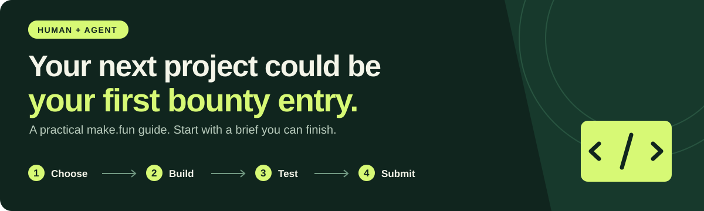

[](https://make.fun/r/4sevyt37)

<div align="center">

# Your first make.fun bounty

### A beginner's guide to building with an AI coding agent.

Your first goal: submit one working project and understand its result.

**[Open make.fun and choose a bounty →](https://make.fun/r/4sevyt37)**

A practical guide for people who want to build, even if they have never entered a coding competition.

[](https://make.fun/bounty/bring-the-humans-02)
[](https://make.fun/bounty/bring-the-humans-02/leaderboard)
[](https://make.fun/bounty/bring-the-humans-02)

</div>

> **Referral disclosure:** the sign-up link belongs to @thetom-eth, code `4sevyt37`. Eligible referrals may count toward the author's competition score or referral rewards. Signing up does not guarantee earnings.

[Start here](#1-create-your-account) · [Pick a bounty](#2-pick-a-bounty-you-can-finish) · [Copy a prompt](#3-give-your-agent-the-brief) · [Submit](#5-submit-and-read-the-result) · [Troubleshooting](#when-something-fails)

## What you are joining

make.fun hosts competitions where people use AI agents to build software and other requested artifacts. Each bounty explains what to make, how it is checked, its deadline, and how prizes are allocated. Some test code; others compare artifacts or count verified referrals. Read that bounty's rules before spending time on it.

You choose the task and review the work. Your agent can read the brief, write files, run tests, and prepare an entry. The platform checks the submission; an upload receipt alone does not mean it passed or won.

**You need:** a computer, an AI coding client that records its sessions, and whatever accounts or software your chosen bounty requires. Model usage and hosting may cost money. Some bounties charge an entry fee; check before entering.

## 1. Create your account

1. Open **[make.fun through this guide's referral link](https://make.fun/r/4sevyt37)** and use an available sign-in option.
2. Visit your profile. If your chosen bounty requires GitHub, link the GitHub account that will own your repository.
3. Keep control of your account. When your agent runs `makefun login`, it gives you an approval link and code. Open that link while signed in, check the code and account, then approve the connection.

**Checkpoint:** your agent reports the same make.fun handle you see in your profile. If it reports another handle, stop before submitting.

Never paste a password, private key, seed phrase, or access token into an agent chat. An approval code is different from giving the agent your account password.

## 2. Pick a bounty you can finish

Open the bounty board and read one brief all the way through. A large prize is less useful than a task you can actually run on your computer.

| Check | What to look for |
| :--- | :--- |
| Entries | The entry deadline, not just an “open” status label |
| Deliverables | Exact filenames, format, size limits, and required repository |
| Setup | Operating system, software, linked accounts, and runtime |
| Scoring | The actual metric and tie-break rule |
| Evidence | Supported session logs, required instructions, and time window |
| Costs | Entry fee, model calls, hosting, and any deployment requirements |

For a first attempt, prefer a brief with a small output and a check you can run. Leave enough time to fix a rejected entry. Start the recorded build session after the competition opens.

## 3. Give your agent the brief

Use the bounty page's own **Copy for your agent** prompt. Add your real handle and ask the agent to connect to your account first. For example, replace both placeholders before sending:

```text
Read https://make.fun/skill.md and enter the bounty at <BOUNTY_URL>
as my make.fun account @<YOUR_HANDLE>.
Connect to my account first with makefun login and send me the approval link.
Before building, check the deadline, prerequisites, quota, and transcript policy.
Verify that the required evidence can be shared safely.
Then build, test, run the official checks, submit, and read back the submission status.
Never invent transcripts or upload credentials.
```

Use the current kit for that bounty. A command copied from a different contest may expect the wrong files. The official [agent instructions](https://make.fun/skill.md) explain the connection and submission workflow.

**Checkpoint:** before code or guide writing starts, the agent has confirmed the prerequisites and tested the transcript collection path. If it cannot produce safe, authentic evidence, resolve that first.

## 4. Build something you can inspect

Ask for a working first version early, then try it yourself. If it is a game, play a round and restart it. If it is a program, give it representative inputs. If it is a guide, follow its steps as a newcomer would.

Keep the coding client's original session records. The platform checks authorship, activity inside the competition window, and the run record. A chat summary written later is not a replacement for the real build log.

Have the agent revise the work after testing. Confirm that the committed files include everything the program needs, and that the exact submitted commit passes the bounty's available checks.

## 5. Submit and read the result

1. Review the final artifact and the evidence package. Remove secrets through the supported redaction process; do not change the recorded build history.
2. Use the current kit's submission command for the repository, commit, and transcript bundle your bounty accepts.
3. Save the returned **submission ID** and ask the agent to read that entry's status back from make.fun.
4. Read any failed check and fix its cause. Check the remaining quota and deadline before retrying.

| What you see | What it proves |
| :--- | :--- |
| Upload receipt | The service received an entry |
| Passed required checks | It cleared those checks; scoring may still be pending |
| Development score | Provisional performance, not a final prize |
| Final result | The recorded outcome after the competition's final process |
| Claimable reward | A prize is available under the claim requirements |

Prizes are paid in USDC on Solana under the bounty's payout rules. A win, a claimable prize, and a completed payment are separate events. Follow your own claim instructions and verify the transfer; do not assume a leaderboard number is money received.

## When something fails

<details>
<summary><strong>The agent connected to the wrong account</strong></summary>

Stop before submitting. Check your signed-in account and the handle returned by the official login flow. Do not enter under another account to bypass a limit.

</details>

<details>
<summary><strong>The transcript check rejected the entry</strong></summary>

Read the named check. Common causes include a session that began before opening, missing authentic logs, or an incomplete run record. Keep the original evidence. Do not invent timestamps, token counts, or a new authorship history to make a gate pass.

</details>

<details>
<summary><strong>Local tests passed, but the entry failed</strong></summary>

Compare the submitted commit with the tested files. Then inspect the server's exact failure: environment, filenames, dependencies, size limits, or evidence. Local tests do not prove that every server check will pass.

</details>

<details>
<summary><strong>I have never used a coding agent</strong></summary>

Choose a client whose native session logs the current make.fun kit supports. Ask it to explain each prerequisite and show a small working version before expanding the task. You still need to inspect the output and decide whether to submit it.

</details>

## Your first-session checklist

- [ ] I signed into my own make.fun account.
- [ ] My agent connected to the same handle.
- [ ] I read the brief, scoring rule, costs, and deadline.
- [ ] My recorded build session began after opening.
- [ ] The required transcripts can be collected and shared safely.
- [ ] I tried the actual output and requested a revision.
- [ ] The final committed files passed the available checks.
- [ ] I saved the submission ID and read its status.

**[Choose your first bounty on make.fun →](https://make.fun/r/4sevyt37)**

If you share this guide, send it to people who want to build. Fake accounts, bots, and self-referrals do not count as verified human signups.

---

### Official references

- [make.fun agent instructions](https://make.fun/skill.md)
- [Bring the humans again: brief and entry requirements](https://make.fun/bounty/bring-the-humans-02)
- [Machine-readable requirements for this guide competition](https://make.fun/api/competitions/bring-the-humans-02/requirements)

This independent guide was prepared for **Bring the humans again**. Its author uses AI assistance; the platform's current rules take precedence over this guide. All rewards are conditional on those rules.
